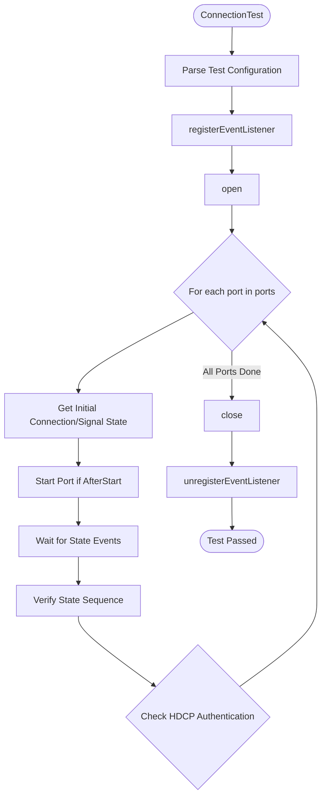
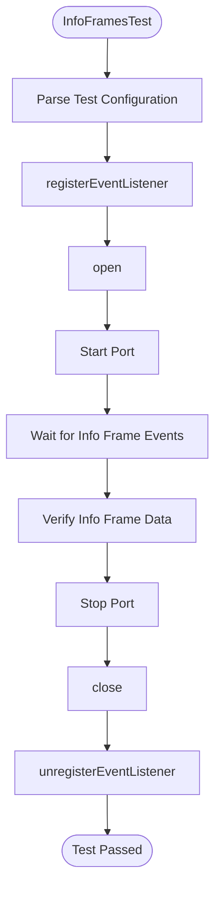
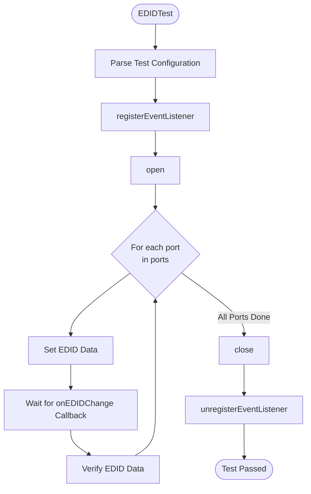
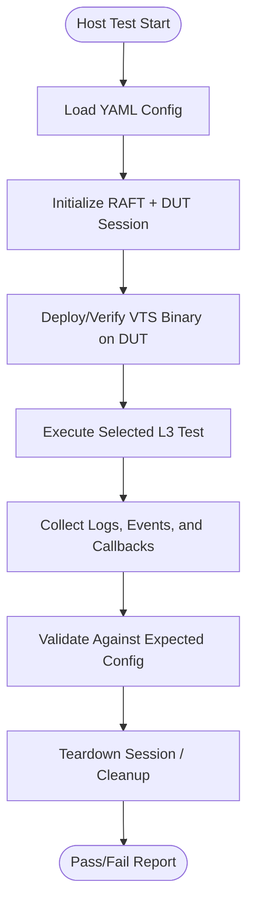

# HDMI INPUT L3 Low Level Test Specification

## Table of Contents

- [Overview](#overview)
- [Acronyms, Terms and Abbreviations](#acronyms-terms-and-abbreviations)
- [References](#references)
- [Level 3 Test Specification](#level-3-test-specification)
    - [DUT Side Implementation](#dut-side-implementation)
    - [HOST Side Implementation](#host-side-implementation)

## Overview

This document defines the Level 3 (L3) Low-Level Test Specification for validating the HDMI INPUT functionality in a device under test (DUT).
The objective of L3 testing is to validate low-level, event-driven state transitions, info frame delivery, and EDID handling through automated test execution using VTS and RAFT frameworks.

The goal is to ensure that:
- HDMI input connection and signal states are reported correctly.
- Info frame call-backs are triggered as expected.
- EDID changes are delivered and verified.

### Acronyms, Terms and Abbreviations

- HAL    - Hardware Abstraction Layer
- VTS    - Vendor Test Suite
- HDMI   - High Definition Multimedia Interface
- L1     - Level 1 Testing
- L2     - Level 2 Testing
- L3     - Level 3 Testing
- DUT    - Device Under Test
- RAFT   - Rapid Automation Framework for Testing
- YAML   - YAML Ain't Markup Language
- AIDL   - Android Interface Definition Language

### References

- High Level Test Specification - [hdmiinput_High-Level_TestSpecification.md](hdmiinput_High-Level_TestSpecification.md)
- [HDMI Input AIDL interface](https://github.com/rdkcentral/rdk-halif-aidl/blob/0.21.0/hdmiinput/)

## Level 3 Test Specification

### DUT Side Implementation

The VTS binary running on the DUT provides key L3 capabilities:

- ConnectionTestAfterOpen: Validate connection and signal state transitions after open.
- ConnectionTestAfterStart: Validate connection and signal state transitions after start.
- InfoFramesTest: Validate info frame call-back delivery and data accuracy.
- EDIDTest: Validate EDID change call-back and data integrity. Also verifies at set EDID is reflecting at source device

#### ConnectionTestAfterOpen / ConnectionTestAfterStart

##### Objective

To verify that the DUT:
- Reports connection and signal states as defined in the test config.
- Delivers state transitions in the expected sequence.
- Negotiates HDCP protocol version and authentication as expected.

##### Flow



##### Configuration File (YAML)

```yaml
hdmiinput:
  L3:
    ConnectionTestAfterOpen:
      ports:
        - id: 0
          source_HDCP_Version: VERSION_1_X
          connection_state_before_open: true
          signal_state_before_open: LOCKED
          connection_state: [false, true, ...]
          signal_state: [NO_SIGNAL, LOCKED, ...]
          max_wait_time_ms: 30000
```

#### InfoFramesTest

##### Objective

To verify that the DUT:
- Delivers info frame callbacks (AUDIO, AVI, SPD, VSIF, VIC, VRR) with correct data.
- Matches received info frame data to expected values in the configuration.

##### Flow



##### Configuration File (YAML)

```yaml
hdmiinput:
  L3:
    InfoFramesTest:
      ports:
        - id: 0
          info_frame_type: [AUDIO, AVI, VIC, VRR]
          frame_data:
            - [0x84, 0x01, ...] # AUDIO
            - [0x82, 0x02, ...] # AVI
            - [VIC16_1920_1080_P_60_16_9] # VIC
            - [true, true, true, 120.0] # VRR
          max_wait_time_ms: 10000
```

#### EDIDTest

##### Objective

To verify that the DUT:
- Accepts EDID changes and triggers the callback.
- Delivers the correct EDID data in the callback.

##### Flow



##### Configuration File (YAML)

```yaml
hdmiinput:
  L3:
    EDIDTest:
      ports:
        - id: 0
          edid: [0x00, 0xFF, ...]
        - id: 1
          edid: [0x00, 0xFF, ...]
```

### Host Side Implementation

The host tests use `RAFT` to control `DUT` execution, collect VTS output/events, and validate expected behaviour from YAML-driven scenarios.

#### Host Test Scope

The host validates the same `L3` behaviour categories as `DUT` side `VTS`:

1. **ConnectionTestAfterOpen**
   - Triggers `DUT` side `ConnectionTestAfterOpen`.
   - Verifies connection and signal state sequence for each configured port.
   - Verifies `HDCP` expectations from configuration.

2. **ConnectionTestAfterStart**
   - Triggers `DUT` side `ConnectionTestAfterStart`.
   - Verifies state transitions after port start.
   - Verifies `HDCP` authentication/version expectations.

3. **InfoFramesTest**
   - Triggers `DUT` side `InfoFramesTest`.
   - Validates callback delivery for configured info-frame types (AUDIO/AVI/SPD/VSIF/VIC/VRR).
   - Compares received frame payload with expected YAML values.

4. **EDIDTest**
   - Triggers DUT-side `EDIDTest`.
   - Applies configured `EDID` data per port.
   - Verifies `onEDIDChange` callback and EDID payload integrity.

#### Host-Side Flow (Python/RAFT)



#### Configuration Responsibility (Host)

The host test layer is responsible for:
- Reading L3 inputs from `YAML` (`hdmiinput.L3.*`).
- Passing scenario parameters to `DUT`-side VTS execution.
- Applying timeout handling (`max_wait_time_ms`) and synchronization.
- Producing pass/fail verdicts with failure diagnostics.